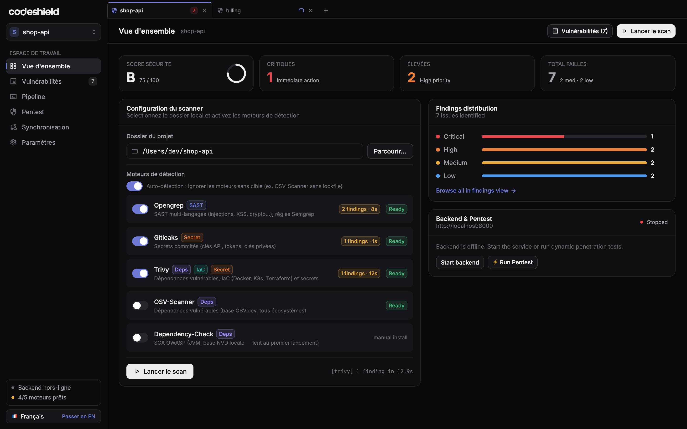
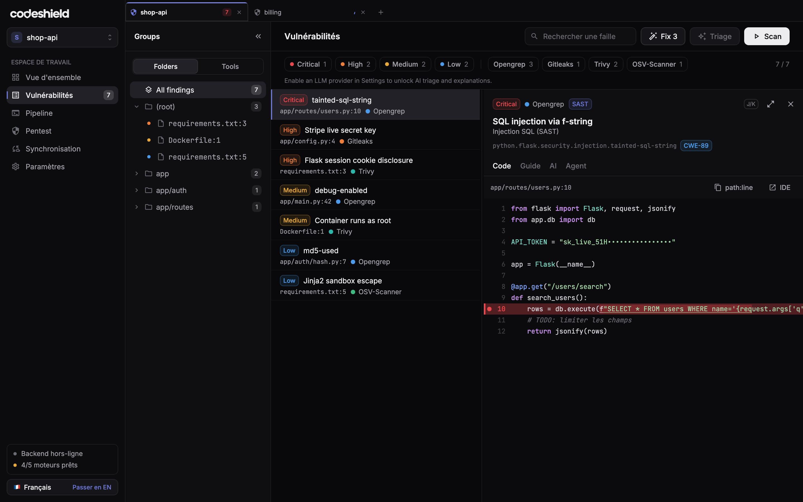
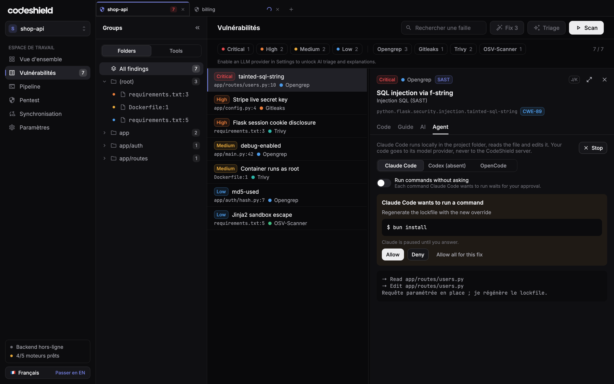

<p align="center">
  <picture>
    <source media="(prefers-color-scheme: dark)" srcset=".github/assets/logo-dark.svg">
    
  </picture>
</p>

<p align="center">Audit de sécurité du code source, sur votre machine.</p>

L'app desktop scanne votre dépôt en local (SAST, secrets, dépendances, IaC) et
lance Claude Code pour corriger les failles, une à une ou toutes les critiques
d'un coup. Votre code ne passe jamais par un serveur CodeShield.

## Aperçu

<!-- Captures rendues hors écran à partir de données d'exemple (desktop/) :
     SNAPSHOTS_SCALE=2 SNAPSHOTS_DIR=/tmp/shots ./gradlew :desktopApp:test --tests '*SnapshotGallery*'
     puis copier overview.png, findings-detail.png (-> findings.png) et agent-permission.png (-> agent.png)
     dans .github/assets/screenshots/. -->

**Vue d'ensemble** : note de sécurité, failles par sévérité et moteurs de scan
(installés par l'app, sans prérequis).



**Failles** : liste filtrable par sévérité et par moteur, code local surligné à
la ligne de la faille.



**Correction par agent** : Claude Code corrige la faille dans le dépôt et
demande votre accord avant chaque commande.



## Télécharger

Les installeurs macOS (`.dmg`), Windows (`.msi`) et Linux (`.deb`) sont publiés
dans les [releases](https://github.com/LordClxt/code-shield/releases).

## Structure

| Dossier | Contenu |
|---|---|
| `desktop/` | App desktop (Kotlin, Compose Multiplatform) |
| `frontend/` | Site de téléchargement (TanStack Start, Bun) |
| `backend-go/` | API Go (synchro des métadonnées, MCP) |
| `contracts/` | Contrat OpenAPI et fixtures partagées |

## Publier une version

```bash
git tag v1.0.0 && git push origin v1.0.0
```

La CI construit les trois installeurs et les attache à la release.
